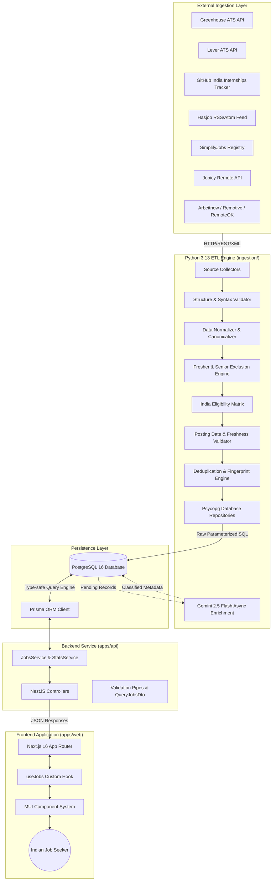
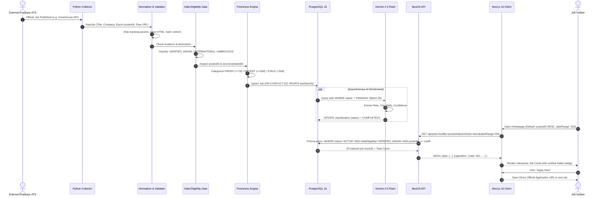

# Document 02: Complete System Architecture — Fresher Jobs India

## Executive Summary & Architectural Overview

Fresher Jobs India is built on an **Asynchronous Pipeline & Decoupled Service Architecture**. The platform cleanly isolates long-running batch ingestion and AI processing from user-facing, low-latency REST query execution and static page rendering.

---

## 1. High-Level Architecture Diagram



---

## 2. Component Interaction & Communication Model

### Simple Explanation
Think of the system as three distinct departments in a company:
1. **The Ingestion Department (Python)**: Works in the background. It scouts the web, extracts job postings, verifies that they are actually in India and for freshers, standardizes the dates, and saves them into the central filing cabinet (PostgreSQL). It also asks Gemini AI to read the job and add useful labels.
2. **The Filing Department (NestJS + PostgreSQL)**: Holds all the data. It ensures that when someone asks for "React jobs in Bengaluru posted in the last 7 days", it searches its sorted index and returns the results in milliseconds.
3. **The Storefront (Next.js)**: The beautiful website the student interacts with. When a student types "Software Engineer" or filters by "Past 30 Days", the storefront calls the filing department, receives the matching jobs, and displays them as clean cards with direct apply buttons.

### Technical Explanation

| Inter-Service Connection | Protocol / Mechanism | Data Format | Security & Resilience |
| :--- | :--- | :--- | :--- |
| **Collectors → External APIs** | HTTPS GET / REST / XML | JSON / Atom XML | Exponential backoff, timeout limits (25–30s), rate limiting delays (0.3s–1.0s) |
| **Python Pipeline → PostgreSQL** | PostgreSQL Wire Protocol (`psycopg` binary) | Parameterized SQL | Connection context managers, transaction isolation, upsert conflict clauses |
| **Python Pipeline → Gemini API** | Google GenAI SDK over HTTPS | JSON Schema (`ClassificationResult`) | Rate-limiting queue, 429 quota exhaustion circuit-breaker |
| **NestJS → PostgreSQL** | Prisma Engine via binary socket | Typed SQL AST | Connection pool (max 10 connections), prepared statements |
| **Next.js Client → NestJS API** | HTTP/1.1 REST (`fetch` via `jobsService`) | JSON (`JobsResponse`, `JobDetail`) | CORS headers (`FRONTEND_URL`), strict DTO validation pipes |
| **End User → External Employer** | Direct HTTP 302 Redirect / `target="_blank"` | HTML | Direct application on official Workday, Greenhouse, or Lever portal |

---

## 3. Complete Data Lifecycle Flow



---

## 4. Subsystem Deep Dive

### Subsystem 1: Ingestion & Validation Subsystem
- **Location**: `ingestion/`
- **Execution Model**: CLI-driven batch jobs (`python main.py --stage all`) or scheduled background jobs via GitHub Actions.
- **Key Modules**:
  - `collectors/`: Source-specific HTTP parsers handling pagination and rate limits.
  - `processors/validators.py`: Rejects empty titles, missing URLs, or malformed payloads.
  - `processors/eligibility.py`: Deterministically filters for entry-level roles (rejecting "Senior", "Lead", "Architect", "5+ years").
  - `processors/india_eligibility.py`: Analyzes location strings, states, cities, and remote scope to determine Indian residency eligibility.
  - `processors/freshness.py`: Compares `postedAt` against UTC current time, categorizing freshness and flagging future or stale dates.

### Subsystem 2: Asynchronous AI Enrichment Subsystem
- **Location**: `ingestion/processors/ai_classifier.py`
- **Execution Model**: Non-blocking worker that processes up to 20 jobs awaiting enrichment per batch.
- **Resilience Design**: If Gemini hits HTTP 429 quota exhaustion, the worker logs `Gemini daily quota exhausted` and gracefully yields without failing the pipeline. The unclassified jobs remain safely stored in the database with status `PENDING` and are enriched in the next available window.

### Subsystem 3: Persistence Subsystem
- **Location**: `apps/api/prisma/schema.prisma` and Docker PostgreSQL container.
- **Relational Tables**:
  - `companies`: Normalizes employer identity (`id`, `name`, `website`, `logoUrl`).
  - `sources`: Tracks data origin (`id`, `name`, `sourceType`, `baseUrl`).
  - `jobs`: Core listing entity (`title`, `location`, `workMode`, `indiaEligibility`, `jobUrl`, `postedAt`, `firstSeenAt`, `lastSeenAt`, `createdAt`).
  - `job_classifications`: 1-to-1 extension table holding AI classification metadata (`role`, `city`, `skills`, `confidence`).
  - `ingestion_logs`: Audit trail recording execution metrics per source run.

### Subsystem 4: Client-Facing Query Subsystem
- **Location**: `apps/api/src/jobs/`
- **Controller**: `jobs.controller.ts` exposes clean REST verbs.
- **Service**: `jobs.service.ts` converts user filters into Prisma `where` criteria, strictly enforcing:
  ```typescript
  {
    status: 'ACTIVE',
    indiaEligibility: 'VERIFIED_INDIAN',
    postedAt: { gte: cutoffDate, not: null }
  }
  ```
- **Ordering**: Primary sort is always `postedAt DESC`, with secondary tiebreaker `id DESC`.

### Subsystem 5: User Interface Subsystem
- **Location**: `apps/web/src/`
- **State Management**: Deeply memoized URL-compatible query state (`params`) handled in `useJobs` hook.
- **Component Hierarchy**:
  - `Header`: Sticky branding with live verified job chip.
  - `JobSearchHeader`: Keyword and city autocomplete inputs.
  - `JobResultsHeader`: Active listing count, Date Range dropdown, and Sort selector.
  - `JobList`: Responsive grid layout rendering `JobCard` items or skeletons.
  - `JobPagination`: MUI Pagination component driving page transitions.
  - `JobDetailPage`: Dynamic route `/jobs/[id]` presenting full job details, original posting timeline, and direct application CTA.

---

## 5. Deployment & Runtime Architecture

```mermaid
graph TB
    subgraph HostEnvironment["Developer Host / Production Server (Docker Host)"]
        subgraph DockerContainer["Docker Service (Port 5434:5432)"]
            PG[(PostgreSQL 16 Alpine)]
            VOL[(Persistent Volume: postgres_data)]
            PG --- VOL
        end

        subgraph NodeRuntime["Node.js 20+ Runtime"]
            API[NestJS REST API :3100]
            WEB[Next.js 16 Web App :3000]
        end

        subgraph PythonRuntime["Python 3.13 Virtualenv (ingestion/venv)"]
            CLI[Ingestion CLI / Pipeline Runner]
        end

        subgraph Automation["GitHub Actions Cloud Runner"]
            CRON[Daily Ingestion Workflow (06:00 UTC)]
        end
    end

    CLI -->|Local Port 5434| PG
    API -->|Local Port 5434 via Prisma| PG
    WEB -->|Local Port 3100 via HTTP| API
    CRON -.->|Remote Ingestion Run| PG
```

### Environment Isolation Strategy
- **Database Isolation**: The local PostgreSQL container runs on host port **`5434`** (mapped internally to standard `5432`). This completely avoids conflicts with default PostgreSQL installations on developer machines.
- **Network Boundaries**: In local development, the Next.js client runs on port `3000`, the NestJS API runs on port `3100`, and PostgreSQL runs on port `5434`.
