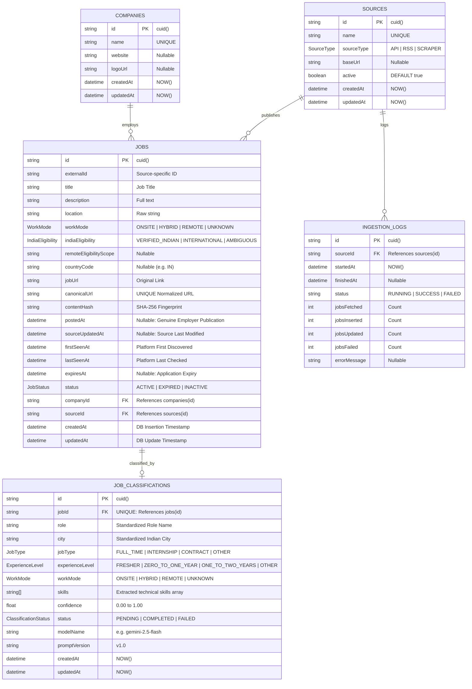

# Document 04: Database Design, Schema Architecture & ER Diagram — Fresher Jobs India

## Executive Summary & Design Principles

The storage layer of Fresher Jobs India is built on **PostgreSQL 16** managed via **Prisma ORM 5.22.0**. The database is normalized to Third Normal Form (3NF) to eliminate data redundancy while maintaining targeted denormalization (such as `companyId` and `sourceId` on `Job`) to maximize read throughput.

---

## 1. Complete Entity-Relationship (ER) Diagram



---

## 2. Table-by-Table Schema Specification

### 2.1 Table: `companies`
- **Purpose**: Normalizes employer entities so multiple jobs from the same company share identity, logos, and websites.
- **Columns**:
  - `id`: `TEXT` (Primary Key, CUID generated).
  - `name`: `TEXT` (Unique, non-nullable). Normalized company name.
  - `website`: `TEXT` (Nullable). Employer homepage.
  - `logoUrl`: `TEXT` (Nullable). Clean URL to company logo icon.
  - `createdAt` / `updatedAt`: `TIMESTAMP(3)` (Default `NOW()`).

### 2.2 Table: `sources`
- **Purpose**: Registry of all integrated data sources (Greenhouse, Lever, Hasjob, GitHub India, etc.).
- **Columns**:
  - `id`: `TEXT` (Primary Key, CUID generated).
  - `name`: `TEXT` (Unique, non-nullable).
  - `sourceType`: `ENUM ('API', 'RSS', 'SCRAPER')`.
  - `baseUrl`: `TEXT` (Nullable). Root URL for source API.
  - `active`: `BOOLEAN` (Default `true`).
  - `createdAt` / `updatedAt`: `TIMESTAMP(3)`.

### 2.3 Table: `jobs`
- **Purpose**: Central listing table representing every ingested opportunity.
- **Columns**:
  - `id`: `TEXT` (Primary Key, CUID generated).
  - `externalId`: `TEXT` (Source-specific unique identifier).
  - `title`: `TEXT` (Original job title).
  - `description`: `TEXT` (Full sanitized job description text).
  - `location`: `TEXT` (Original raw location string).
  - `workMode`: `ENUM ('ONSITE', 'HYBRID', 'REMOTE', 'UNKNOWN')`.
  - `indiaEligibility`: `ENUM ('VERIFIED_INDIAN', 'INTERNATIONAL', 'AMBIGUOUS')`.
  - `remoteEligibilityScope`: `TEXT` (Nullable: e.g. "India Only", "Worldwide").
  - `countryCode`: `TEXT` (Nullable: "IN").
  - `jobUrl`: `TEXT` (Direct application URL).
  - `canonicalUrl`: `TEXT` (Unique, tracking-stripped normalized URL).
  - `contentHash`: `TEXT` (Nullable, SHA-256 fingerprint of title + company + location).
  - `postedAt`: `TIMESTAMP(3)` (Nullable: Genuine employer posting date).
  - `sourceUpdatedAt`: `TIMESTAMP(3)` (Nullable: Date source updated listing).
  - `firstSeenAt`: `TIMESTAMP(3)` (Default `NOW()`: First platform discovery).
  - `lastSeenAt`: `TIMESTAMP(3)` (Default `NOW()`: Last crawler confirmation).
  - `expiresAt`: `TIMESTAMP(3)` (Nullable: Application cutoff date).
  - `status`: `ENUM ('ACTIVE', 'EXPIRED', 'INACTIVE')` (Default `'ACTIVE'`).
  - `companyId`: `TEXT` (Foreign Key referencing `companies.id`, `ON DELETE RESTRICT`).
  - `sourceId`: `TEXT` (Foreign Key referencing `sources.id`, `ON DELETE RESTRICT`).
  - `createdAt` / `updatedAt`: `TIMESTAMP(3)`.

### 2.4 Table: `job_classifications`
- **Purpose**: 1-to-1 extension table storing AI enrichment results.
- **Columns**:
  - `id`: `TEXT` (Primary Key, CUID generated).
  - `jobId`: `TEXT` (Unique Foreign Key referencing `jobs.id`, `ON DELETE CASCADE`).
  - `role`: `TEXT` (Nullable: Standardized role e.g. "Software Engineer").
  - `city`: `TEXT` (Nullable: Standardized Indian city e.g. "Bengaluru").
  - `jobType`: `ENUM ('FULL_TIME', 'INTERNSHIP', 'CONTRACT', 'OTHER')`.
  - `experienceLevel`: `ENUM ('FRESHER', 'ZERO_TO_ONE_YEAR', 'ONE_TO_TWO_YEARS', 'OTHER')`.
  - `workMode`: `ENUM ('ONSITE', 'HYBRID', 'REMOTE', 'UNKNOWN')`.
  - `skills`: `TEXT[]` (Array of clean technical skill names).
  - `confidence`: `DOUBLE PRECISION` (Nullable: 0.00 to 1.00 score).
  - `status`: `ENUM ('PENDING', 'COMPLETED', 'FAILED')` (Default `'PENDING'`).
  - `modelName`: `TEXT` (Nullable: e.g. "gemini-2.5-flash").
  - `promptVersion`: `TEXT` (Default `'v1.0'`).
  - `createdAt` / `updatedAt`: `TIMESTAMP(3)`.

### 2.5 Table: `ingestion_logs`
- **Purpose**: Comprehensive audit log recording every single collector execution.
- **Columns**:
  - `id`: `TEXT` (Primary Key, CUID generated).
  - `sourceId`: `TEXT` (Foreign Key referencing `sources.id`, `ON DELETE CASCADE`).
  - `startedAt`: `TIMESTAMP(3)` (Default `NOW()`).
  - `finishedAt`: `TIMESTAMP(3)` (Nullable).
  - `status`: `TEXT` ("RUNNING", "SUCCESS", "FAILED").
  - `jobsFetched`: `INTEGER` (Default 0).
  - `jobsInserted`: `INTEGER` (Default 0).
  - `jobsUpdated`: `INTEGER` (Default 0).
  - `jobsFailed`: `INTEGER` (Default 0).
  - `errorMessage`: `TEXT` (Nullable).

---

## 3. Database Indexes & Query Optimization

To guarantee sub-20ms response times across 12,000+ total rows, the following B-tree indexes are implemented in PostgreSQL:

| Index Name | Table | Indexed Columns | Justification / Query Accelerated |
| :--- | :--- | :--- | :--- |
| `jobs_postedAt_idx` | `jobs` | `(postedAt)` | Accelerates primary `ORDER BY postedAt DESC` and `postedAt >= cutoff` queries |
| `jobs_firstSeenAt_idx` | `jobs` | `(firstSeenAt)` | Accelerates discovery audits and timeline tracking |
| `jobs_lastSeenAt_idx` | `jobs` | `(lastSeenAt)` | Accelerates daily refresh expiry sweeps (`mark_expired_jobs`) |
| `jobs_indiaEligibility_idx`| `jobs` | `(indiaEligibility)`| High-selectivity filter restricting public API to `VERIFIED_INDIAN` |
| `jobs_status_idx` | `jobs` | `(status)` | Filters out inactive and expired records (`status = 'ACTIVE'`) |
| `jobs_workMode_idx` | `jobs` | `(workMode)` | Accelerates faceted filtering by Onsite / Hybrid / Remote |
| `jobs_countryCode_idx` | `jobs` | `(countryCode)` | Fast country boundary verification |
| `jobs_companyId_idx` | `jobs` | `(companyId)` | Accelerates joins between `jobs` and `companies` |
| `jobs_sourceId_idx` | `jobs` | `(sourceId)` | Accelerates source-specific audits and queries |
| `job_classifications_city_idx` | `job_classifications`| `(city)` | Accelerates city filter (`Bengaluru`, `Pune`, `Mumbai`, etc.) |
| `job_classifications_role_idx` | `job_classifications`| `(role)` | Accelerates standardized role search (`Software Engineer`, etc.) |
| `job_classifications_status_idx`| `job_classifications`| `(status)` | Fast query for pending AI batch classification (`WHERE status = 'PENDING'`) |

---

## 4. Multi-Layer Deduplication Constraints

Duplicate job prevention is enforced through three distinct mechanisms:

1. **Unique Constraint on Source + External ID**:
   ```sql
   CONSTRAINT "jobs_sourceId_externalId_key" UNIQUE ("sourceId", "externalId")
   ```
   *Guarantees that re-fetching an existing job from the same source never creates a duplicate row.*

2. **Unique Constraint on Canonical URL**:
   ```sql
   CONSTRAINT "jobs_canonicalUrl_key" UNIQUE ("canonicalUrl")
   ```
   *Guarantees that two identical jobs with tracking parameters (e.g. `?utm_source=linkedin` vs `?ref=simpl`) map to the exact same canonical record.*

3. **Application-Layer Content Hashing**:
   `content_hasher.py` generates an SHA-256 fingerprint of `normalized_title + normalized_company + normalized_location`. Cross-source identical listings share this fingerprint.

---

## 5. Migration History

All structural changes to the database are tracked in version-controlled migration files in `apps/api/prisma/migrations/`:

1. **`20261116090001_init`**: Created initial schemas for `companies`, `sources`, `jobs`, `job_classifications`, and `ingestion_logs`.
2. **`20261116123652_add_india_eligibility`**: Introduced the `IndiaEligibility` enum (`VERIFIED_INDIAN`, `INTERNATIONAL`, `AMBIGUOUS`) and indexed columns `countryCode`, `workMode`, and `indiaEligibility`.
3. **`20261117103000_add_canonical_dates`**: Introduced canonical timestamps `sourceUpdatedAt`, `firstSeenAt`, and `lastSeenAt`, accompanied by B-tree indexes on `postedAt`, `firstSeenAt`, and `lastSeenAt`.
