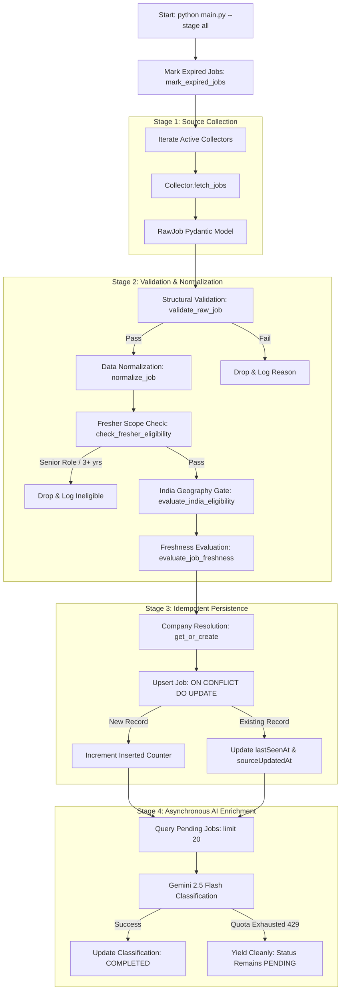

# Document 05: Python Data Ingestion Pipeline Deep Dive — Fresher Jobs India

## Executive Summary & Processing Philosophy

The ingestion pipeline (`ingestion/`) is an autonomous, fault-tolerant Python 3.13 ETL pipeline designed to extract thousands of raw postings from heterogeneous external job sources, sanitize and normalize their payloads, deterministically reject senior and international listings, preserve official publication dates, and persist verified opportunities idempotently into PostgreSQL.

---

## 1. Pipeline Execution Flow



---

## 2. Source Collectors Breakdown

Every collector inherits from `BaseCollector` (`ingestion/collectors/base.py`), which manages HTTP connection pooling via `httpx.Client`, request timeouts, and rate-limiting delays.

### 2.1 Greenhouse Collector (`ingestion/collectors/greenhouse.py`)
- **Protocol**: HTTPS REST (`https://boards-api.greenhouse.io/v1/boards/{company}/jobs?content=true`).
- **Target Companies**: 33 verified employers with major tech centers in India (e.g. Databricks, Rubrik, Thoughtworks, InMobi, Okta, Twilio, Stripe, Pure Storage, Cloudflare, Datadog).
- **Date Handling**: Strictly prefers `first_published` timestamp. Falls back to `updated_at`. Never falls back to `now()`.
- **Location Parsing**: Inspects Greenhouse office metadata and location strings.

### 2.2 Lever Collector (`ingestion/collectors/lever.py`)
- **Protocol**: HTTPS REST (`https://api.lever.co/v0/postings/{company}?mode=json`).
- **Target Companies**: 19 leading tech firms (Paytm, Meesho, Cred, Zeta, etc.).
- **Date Handling**: Converts epoch millisecond integer `createdAt` (e.g. `1731804000000`) into a timezone-aware UTC datetime.
- **Location Parsing**: Extracts Lever `categories.location` and `categories.commitment`.

### 2.3 GitHub India Internships Collector (`ingestion/collectors/github_india.py`)
- **Protocol**: HTTPS GET fetching daily aggregated JSON (`https://raw.githubusercontent.com/Sarthzk/internship-tracker/main/data/listings.json`).
- **Target Scope**: 160+ major companies actively hiring software engineering interns and freshers in India.
- **Date Handling**: Parses ISO `date_posted` or `first_seen`. Records `last_seen` as `sourceUpdatedAt`.

### 2.4 Hasjob Collector (`ingestion/collectors/hasjob.py`)
- **Protocol**: HTTPS Atom XML feed (`https://hasjob.co/feed`).
- **Target Scope**: Direct postings from Indian startups and technology product companies via Hasgeek.
- **Parsing**: Standard XML parsing extracting `<atom:entry>`, `<atom:title>`, `<atom:published>`, and application links.

### 2.5 SimplifyJobs Collector (`ingestion/collectors/simplify_jobs.py`)
- **Protocol**: HTTPS JSON registry (`New-Grad-Positions` and `Summer2025-Internships`).
- **Target Scope**: Verified college graduate roles linking directly to company Workday, Greenhouse, or Ashby portals.

### 2.6 Remote Job Collectors (`jobicy.py`, `arbeitnow.py`, `remotive.py`, `remoteok.py`)
- **Protocol**: Public REST APIs delivering structured JSON.
- **Verification Rule**: Must pass India validation matrix. "Worldwide Remote" is quarantined as `AMBIGUOUS`; only listings explicitly open to Indian candidates are marked `VERIFIED_INDIAN`.

### 2.7 Naukri Collector (`ingestion/collectors/naukri.py`)
- **Protocol**: Dedicated optional collector.
- **Security Compliance**: Strictly honors bot protection and terms of service. Does not bypass CAPTCHAs or Cloudflare anti-bot systems. Skips cleanly with a clear warning if commercial credentials are not supplied.

---

## 3. Data Normalization: Before & After Example

The normalizer (`ingestion/processors/normalizer.py`) converts irregular source payloads into the standardized Pydantic `NormalizedJob` model.

### Raw Input (Greenhouse API Payload Snippet):
```json
{
  "id": 5678901,
  "title": "Software Engineer 1 - Distributed Systems",
  "updated_at": "2026-11-16T23:39:10.000Z",
  "first_published": "2026-11-16T23:39:10.000Z",
  "absolute_url": "https://boards.greenhouse.io/okta/jobs/5678901?gh_src=linkedin_feed",
  "location": {
    "name": "Bengaluru, Karnataka, India"
  },
  "content": "&lt;p&gt;Okta is looking for a Software Engineer to join our Bangalore R&amp;D center...&lt;/p&gt;"
}
```

### Transformed `NormalizedJob` Model:
```json
{
  "external_id": "5678901",
  "source_name": "Greenhouse",
  "title": "Software Engineer 1 - Distributed Systems",
  "company_name": "Okta",
  "description": "Okta is looking for a Software Engineer to join our Bangalore R&D center...",
  "location": "Bengaluru",
  "work_mode": "ONSITE",
  "india_eligibility": "VERIFIED_INDIAN",
  "job_url": "https://boards.greenhouse.io/okta/jobs/5678901",
  "canonical_url": "https://boards.greenhouse.io/okta/jobs/5678901",
  "content_hash": "a8f9c2d1e04b7863...",
  "posted_at": "2026-11-16T23:39:10+00:00",
  "source_updated_at": "2026-11-16T23:39:10+00:00",
  "tags": ["India", "Bengaluru", "Software Engineer"]
}
```

---

## 4. Verification & Validation Rules

### 4.1 Structural Validation (`validators.py`)
Rejects malformed records:
- Job title must be non-empty and >= 3 characters.
- Company name must be non-empty and >= 2 characters.
- Job URL must be a valid HTTP or HTTPS address.
- Description must be >= 20 characters.

### 4.2 Fresher Eligibility & Senior Exclusion (`eligibility.py`)
Enforces that only early-career candidates see these jobs:
- **Accepted Keywords**: `fresher`, `intern`, `internship`, `trainee`, `graduate`, `entry level`, `junior`, `associate`, `0 years`, `1 year`, `0-1 year`, `0-2 years`.
- **Rejected Titles (Hard Blacklist)**: `Senior`, `Sr.`, `Lead`, `Principal`, `Staff`, `Architect`, `Director`, `VP`, `Manager`, `Head of`, `Consultant`.
- **Rejected Experience**: Explicit regex matches for `3+ years`, `5+ years`, `7+ years`.

### 4.3 India Eligibility Matrix (`india_eligibility.py`)

A company's corporate headquarters does not determine job location. Every listing is evaluated across:
1. **Primary Indian Tech Hubs**: Bengaluru (Bangalore), Hyderabad, Pune, Mumbai (Bombay), Delhi, Gurugram (Gurgaon), Noida, Chennai (Madras), Kolkata (Calcutta), Ahmedabad, Kochi, Thiruvananthapuram, Indore, Coimbatore, Chandigarh, Jaipur.
2. **Indian States & Union Territories**: Karnataka, Maharashtra, Telangana, Tamil Nadu, Haryana, Uttar Pradesh, Kerala, West Bengal, Gujarat, etc.
3. **Country Identifiers**: `India`, `, IN`, `country: India`.
4. **False Positive Guardrails**: Excludes `Indiana`, `Indianapolis`, `IN, US` from matching India.
5. **Classification Outcomes**:
   - `VERIFIED_INDIAN`: Job has verified location in India or is explicitly remote within India.
   - `INTERNATIONAL`: Job has confirmed overseas location (e.g. "London, UK", "New York, NY", "Canada").
   - `AMBIGUOUS`: Generic "Worldwide Remote" or missing location without Indian confirmation. Quarantined from the default public feed.

---

## 5. Canonical Date Integrity & Deduplication Mechanics

### PostgreSQL Upsert Query (`job_repository.py`)
When a collector re-fetches a job, it executes the following parameterized SQL:

```sql
INSERT INTO "jobs" (
    "id", "externalId", "title", "description", "location", "workMode",
    "indiaEligibility", "remoteEligibilityScope", "countryCode", "jobUrl",
    "canonicalUrl", "contentHash", "postedAt", "sourceUpdatedAt",
    "firstSeenAt", "lastSeenAt", "status", "companyId", "sourceId",
    "createdAt", "updatedAt"
) VALUES (
    %s, %s, %s, %s, %s, %s, %s, %s, %s, %s, %s, %s, %s, %s, NOW(), NOW(), 'ACTIVE', %s, %s, NOW(), NOW()
)
ON CONFLICT ("sourceId", "externalId") DO UPDATE SET
    "lastSeenAt" = NOW(),
    "sourceUpdatedAt" = COALESCE(EXCLUDED."sourceUpdatedAt", "jobs"."sourceUpdatedAt"),
    "status" = 'ACTIVE',
    "updatedAt" = NOW()
RETURNING "id", (xmax = 0) AS "is_new";
```

### Critical Invariants Enforced:
1. `postedAt` is **NEVER modified or overwritten** with `NOW()`. The original employer publication timestamp remains pristine.
2. `firstSeenAt` is **preserved** to track exact discovery history.
3. `lastSeenAt` is refreshed to current time, proving the posting was confirmed active on this run.

---

## 6. Daily Expiry Sweeps (`mark_expired_jobs`)

At the start of every ingestion run (Step 0), the pipeline automatically sweeps for expired listings:
```sql
UPDATE "jobs"
SET "status" = 'EXPIRED', "updatedAt" = NOW()
WHERE "status" = 'ACTIVE'
  AND ("expiresAt" < NOW() OR "lastSeenAt" < NOW() - INTERVAL '30 days')
RETURNING "id";
```
Listings that disappear from external sources for more than 30 days are automatically retired to prevent applicant frustration.

---

## 7. CLI Execution Commands

```bash
# 1. Full Ingestion & Classification (All Sources, 5 pages per source)
python ingestion/main.py --stage all

# 2. Ingest from Single Source with custom page depth
python ingestion/main.py --stage collect --source greenhouse --pages 35
python ingestion/main.py --stage collect --source lever --pages 20
python ingestion/main.py --stage collect --source github_india

# 3. Execute Asynchronous AI Classification on pending records (batch of 20)
python ingestion/main.py --stage classify --limit 20

# 4. Verify PostgreSQL Database Connectivity
python ingestion/main.py --stage test-db
```
