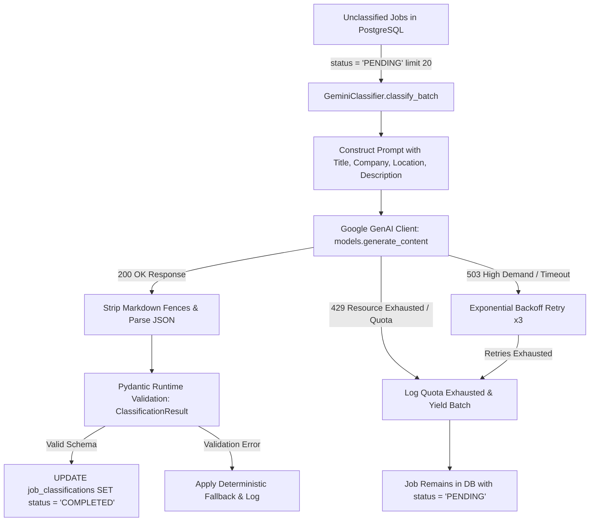

# Document 06: LLM & Generative AI Classification Deep Dive — Fresher Jobs India

## Executive Summary & AI Philosophy

Fresher Jobs India integrates Google's **Gemini 2.5 Flash** (`gemini-2.5-flash`) via the official Google GenAI SDK (`google-genai`) to solve the semantic extraction and categorization problem. 

The AI pipeline is designed under an **Asynchronous Graceful Degradation** model: AI enrichment is an enhancement layer, not a bottleneck. If Gemini encounters rate limits (HTTP 429) or high demand (HTTP 503), the collection pipeline continues with 100% throughput, saving pending jobs for future enrichment windows.

---

## 1. Why an LLM Over Pure Regular Expressions?

### Simple Explanation
Imagine trying to write regex rules for thousands of different job titles. If someone writes "SDE-1", "Graduate Engineer Trainee", "Junior React Architect", or "Full Stack Apprentice", a simple keyword rule might miss the role or incorrectly classify someone as a Senior because the description says "will work closely with Senior Developers". 

An LLM reads the description with human-level comprehension, understands the context, extracts the exact technologies required (even if written in informal bullet points), normalizes the city name (e.g. converting "Gurgaon" to "Gurugram"), and scores its own confidence.

### Technical Explanation
1. **Semantic Contextual Awareness**: Regex cannot easily distinguish between *"Requires 5 years of experience"* (an ineligible role) and *"You will report to an Engineering Manager with 5 years of experience"* (a legitimate fresher role). An LLM evaluates grammatical syntax and dependency trees.
2. **Entity Normalization (NER)**: Translates hundreds of company-specific variations ("Member of Technical Staff 1", "Associate Application Developer", "Software Engineer - Campus 2026") into standardized search taxonomy (`Frontend Developer`, `Backend Developer`, `Full Stack Developer`, `Data Scientist`, `DevOps Engineer`, `QA Engineer`, `UI/UX Designer`, `Product Manager`, `Other`).
3. **Structured Skill Extraction**: Parses dense, unstructured job descriptions and extracts clean arrays of canonical tech skills (e.g. `['Python', 'FastAPI', 'PostgreSQL', 'Docker']`) while discarding conversational noise.

---

## 2. Gemini 2.5 Flash Integration Architecture



### Configuration & Model Hyperparameters
- **Provider**: Google AI Studio / Gemini API
- **Model**: `gemini-2.5-flash`
- **Output Mode**: `response_mime_type="application/json"`
- **SDK**: `google-genai >= 3.3.0`
- **Batch Size**: 20 jobs per execution
- **Per-Job Request Interval**: 4.0 seconds (respects Free Tier 5 requests per minute guideline)
- **Retry Strategy**: 3 attempts with exponential jitter backoff

---

## 3. System Prompt & Few-Shot Instruction Design

The prompt (`ingestion/processors/classification_prompt.py`) enforces strict JSON extraction according to the platform's enum specifications:

### Prompt Template Snippet:
```text
You are an expert technical recruiter specializing in entry-level and fresher jobs in India.
Analyze the following job posting and return a JSON object strictly matching this schema:

{
  "role": "<One of: Frontend Developer, Backend Developer, Full Stack Developer, Mobile Developer, DevOps Engineer, QA Engineer, Data Scientist, Data Analyst, Machine Learning Engineer, Cloud Engineer, Security Engineer, Product Manager, UI/UX Designer, Other>",
  "city": "<Primary Indian city e.g. Bengaluru, Hyderabad, Pune, Mumbai, Gurugram, Noida, Chennai, Delhi, or null>",
  "job_type": "<One of: FULL_TIME, INTERNSHIP, CONTRACT, OTHER>",
  "experience_level": "<One of: FRESHER, ZERO_TO_ONE_YEAR, ONE_TO_TWO_YEARS, OTHER>",
  "work_mode": "<One of: ONSITE, HYBRID, REMOTE, UNKNOWN>",
  "skills": ["<Array of 3 to 10 specific technical skills, e.g. React, Python, PostgreSQL>"],
  "confidence": <Float between 0.00 and 1.00 indicating classification confidence>
}

Rules:
1. "role" must map to the closest standardized category.
2. "city" must be a recognized Indian tech hub or null if ambiguous/remote.
3. "confidence" must be lower than 0.70 if the description is brief, vague, or missing.
4. Output raw JSON only. Do not include markdown fences, comments, or explanations.
```

---

## 4. Pydantic Output Validation & Schema Enforcement

To prevent LLM hallucinations from corrupting the database, the output is parsed through the `ClassificationResult` Pydantic model (`ingestion/schemas/__init__.py`):

```python
class ClassificationResult(BaseModel):
    role: Optional[str] = None
    city: Optional[str] = None
    job_type: JobTypeEnum = JobTypeEnum.OTHER
    experience_level: ExperienceLevelEnum = ExperienceLevelEnum.OTHER
    work_mode: WorkModeEnum = WorkModeEnum.UNKNOWN
    skills: List[str] = Field(default_factory=list)
    confidence: float = Field(ge=0.0, le=1.0, default=0.5)

    @field_validator("skills", mode="before")
    def clean_skills(cls, v):
        if isinstance(v, list):
            return [str(s).strip() for s in v if s and len(str(s).strip()) <= 50][:15]
        return []
```

### JSON Sanitization & Parsing Resilience
- `classification_validator.py` strips markdown code blocks (````json ... ````) automatically if returned by the model.
- If the model returns an invalid enum value (e.g. `job_type: "PART_TIME"`), the validator gracefully falls back to `OTHER` rather than raising an unhandled exception.

---

## 5. Failure Scenarios & Circuit Breaking

| Scenario | Symptom / Error | Handling in Ingestion Engine |
| :--- | :--- | :--- |
| **Daily Quota Exhausted** | `429 RESOURCE_EXHAUSTED` (Limit: 20 RPD on Free Tier) | Logs `Gemini daily quota exhausted. Skipping further AI classification calls.` Pipeline completes successfully with code 0; unclassified jobs remain safely stored in DB. |
| **Spike Rate Limit** | `429 Too Many Requests` (5 RPM) | Evaluates Google's `RetryInfo.retryDelay`. If delay > 20s, yields the batch to avoid hanging the pipeline; if <= 20s, sleeps and retries. |
| **API High Demand** | `503 UNAVAILABLE` | Retries up to 3 times with 1.0s and 2.0s progressive delays. |
| **Malformed JSON** | Output parsing exception | Drops to deterministic rule-based extractor; records `confidence = 0.40`. |
| **Database Failure** | DB connection drops during write | Ingestion transaction rolls back; classification status remains `PENDING`. |

---

## 6. Token Economics & Cost Calculation Methodology

To understand AI operational costs at scale, we evaluate token usage based on official Gemini pricing.

### Cost Parameters (Gemini 2.5 Flash Pay-as-you-go Pricing):
- **Input Tokens**: \$0.075 per 1,000,000 tokens (\$0.000075 / 1k tokens)
- **Output Tokens**: \$0.30 per 1,000,000 tokens (\$0.000300 / 1k tokens)

### Per-Job Token Profile (Empirical Averages from Live Telemetry):
- **Average Input Tokens per Job**: ~450 tokens (Prompt instructions + Job Title + Company + Location + First 1,500 characters of description).
- **Average Output Tokens per Job**: ~65 tokens (Structured JSON response).

### Cost Formula:
$$\text{Cost per 1,000 Jobs} = \left( 1,000 \times \frac{450}{1,000,000} \times \$0.075 \right) + \left( 1,000 \times \frac{65}{1,000,000} \times \$0.30 \right)$$
$$\text{Input Cost} = 0.45 \times \$0.075 = \$0.03375$$
$$\text{Output Cost} = 0.065 \times \$0.30 = \$0.01950$$
$$\mathbf{\text{Total Cost per 1,000 Jobs}} = \mathbf{\$0.05325} \text{ (Approx. 5.3 cents USD or ₹4.40 INR)}$$

*Conclusion*: Classifying **10,000 fresh jobs** costs approximately **\$0.53 USD**, demonstrating extraordinary cost efficiency for production operation.
