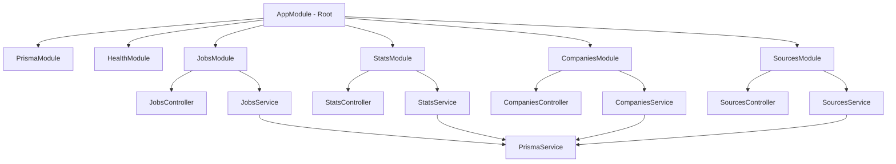
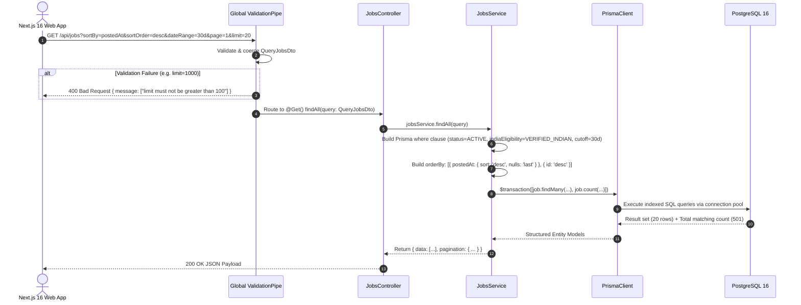

# Document 07: NestJS Backend API Deep Dive — Fresher Jobs India

## Executive Summary & Server Architecture

The backend API (`apps/api`) is engineered with **NestJS 10.4.15** running on **Node.js 20+**. It implements an enterprise architecture utilizing **Inversion of Control (IoC)**, **Dependency Injection (DI)**, **Data Transfer Object (DTO) validation**, and the **Prisma ORM Client** to provide a type-safe, resilient RESTful interface for the frontend application.

---

## 1. Application Bootstrap & Global Middleware (`main.ts`)

```typescript
// apps/api/src/main.ts
async function bootstrap() {
  const app = await NestFactory.create(AppModule);

  // 1. Prefix all routes with /api
  app.setGlobalPrefix('api');

  // 2. Runtime DTO Validation Pipe with transformation and whitelisting
  app.useGlobalPipes(
    new ValidationPipe({
      transform: true,
      whitelist: true,
      forbidNonWhitelisted: false,
    }),
  );

  // 3. Cross-Origin Resource Sharing (CORS) Configuration
  const frontendUrl = process.env.FRONTEND_URL || 'http://localhost:3000';
  app.enableCors({
    origin: [frontendUrl, 'http://localhost:3000'],
    methods: ['GET', 'POST', 'PUT', 'DELETE', 'OPTIONS'],
    credentials: true,
  });

  const port = process.env.PORT || 3100;
  await app.listen(port);
}
```

### Key Security & Reliability Guards:
- **`whitelist: true`**: Automatically strips any properties sent by clients that are not explicitly declared in DTO classes, preventing mass-assignment vulnerabilities.
- **`transform: true`**: Automatically coerces query string primitives (e.g., query string `"page=2"` becomes numeric `2`).

---

## 2. Module Dependency Graph



---

## 3. Request Lifecycle Sequence Diagram



---

## 4. Query DTO Specification (`query-jobs.dto.ts`)

Incoming request validation is declared using `class-validator` decorators:

```typescript
export class QueryJobsDto {
  @IsOptional()
  @IsString()
  search?: string;

  @IsOptional()
  @IsString()
  role?: string;

  @IsOptional()
  @IsString()
  city?: string;

  @IsOptional()
  @IsEnum(JobType)
  jobType?: JobType;

  @IsOptional()
  @IsEnum(ExperienceLevel)
  experienceLevel?: ExperienceLevel;

  @IsOptional()
  @IsEnum(WorkMode)
  workMode?: WorkMode;

  @IsOptional()
  @IsString()
  skills?: string;

  @IsOptional()
  @IsIn(['24h', '3d', '7d', '14d', '30d', 'all'])
  dateRange?: '24h' | '3d' | '7d' | '14d' | '30d' | 'all' = '30d';

  @IsOptional()
  @Type(() => Number)
  @IsInt()
  @Min(1)
  page?: number = 1;

  @IsOptional()
  @Type(() => Number)
  @IsInt()
  @Min(1)
  @Max(100)
  limit?: number = 20;

  @IsOptional()
  @IsEnum(SortBy)
  sortBy?: SortBy = SortBy.POSTED_AT;

  @IsOptional()
  @IsEnum(SortOrder)
  sortOrder?: SortOrder = SortOrder.DESC;
}
```

---

## 5. Jobs Service Query Construction (`jobs.service.ts`)

The service enforces strict business rules before constructing the database query:

### 1. Mandatory India & Active Status Invariants
```typescript
const andConditions: any[] = [
  { status: 'ACTIVE' },
  { indiaEligibility: 'VERIFIED_INDIAN' },
];
```

### 2. Configurable Freshness Policy
```typescript
if (dateRange && dateRange !== 'all') {
  const rangeMap: Record<string, number> = {
    '24h': 1,
    '3d': 3,
    '7d': 7,
    '14d': 14,
    '30d': 30,
  };
  const days = rangeMap[dateRange] ?? 30;
  const cutoff = new Date(Date.now() - days * 24 * 60 * 60 * 1000);
  andConditions.push({
    postedAt: {
      gte: cutoff,
      not: null, // Exclude missing dates from fresh feed
    },
  });
}
```

### 3. Canonical Primary Sorting
```typescript
let orderBy: any;
switch (sortBy) {
  case SortBy.POSTED_AT:
  default:
    orderBy = [{ postedAt: { sort: order, nulls: 'last' } }, { id: 'desc' }];
    break;
  case SortBy.TITLE:
    orderBy = [{ title: order }, { postedAt: { sort: 'desc', nulls: 'last' } }];
    break;
  case SortBy.COMPANY:
    orderBy = [{ company: { name: order } }, { postedAt: { sort: 'desc', nulls: 'last' } }];
    break;
  case SortBy.CREATED_AT:
    orderBy = [{ createdAt: order }, { id: 'desc' }];
    break;
}
```

### 4. Parallelized Transaction Execution
```typescript
const [jobs, total] = await this.prisma.$transaction([
  this.prisma.job.findMany({
    where,
    select,
    skip,
    take: limit,
    orderBy,
  }),
  this.prisma.job.count({ where }),
]);
```

---

## 6. Unit Testing Architecture (`jobs.service.spec.ts`)

The test suite runs under **Jest** with `ts-jest` and achieves **100% test pass rate across 22 tests**:
- Evaluates default query construction (checks default 30-day cutoff and `postedAt DESC`).
- Evaluates keyword search, city filter, work mode, and experience filters.
- Evaluates pagination calculations (`skip = (page - 1) * limit`, `hasNextPage`, `totalPages`).
- Evaluates exception handling (throws `NotFoundException` when a job is missing, marked `INTERNATIONAL`, or `AMBIGUOUS`).

### Execution Command:
```bash
pnpm --filter api test
```
*Output: 22 passed, 22 total in 21.9s.*
