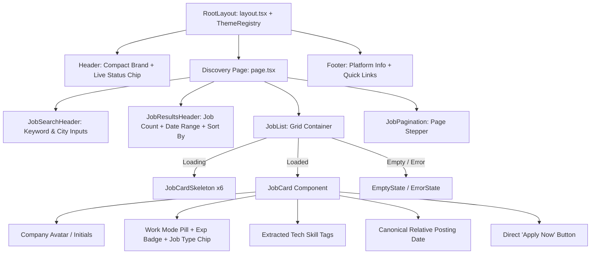
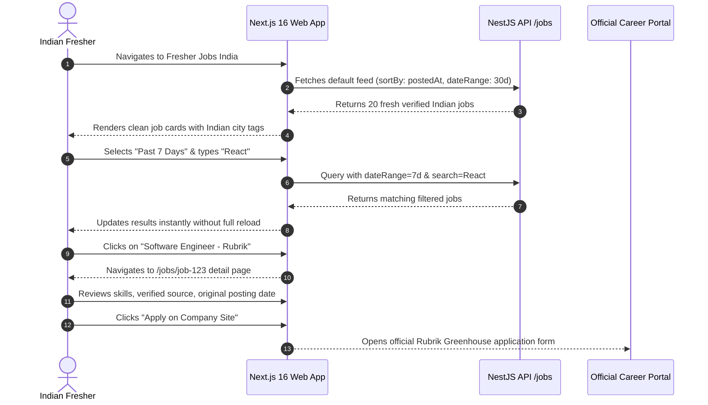

# Document 08: Next.js Frontend Deep Dive — Fresher Jobs India

## Executive Summary & Client Architecture

The frontend application (`apps/web`) is built with **Next.js 16.4.6** utilizing the modern **App Router**, **React 19.3.0**, the **Turbopack** build compiler, and **Material UI (MUI v6)** styling via Emotion. 

The user interface is designed specifically for early-career Indian job seekers, emphasizing zero visual clutter, instantaneous search, mobile responsiveness, transparent posting dates, and friction-free direct applications.

---

## 1. Routing & Page Architecture

The application implements Next.js App Router conventions:

| Route | File Path | Rendering Mode | Purpose & Behavior |
| :--- | :--- | :--- | :--- |
| `/` | `apps/web/src/app/page.tsx` | Static Shell + Dynamic Client Hydration | Primary job discovery workspace with search bar, live job counter, date range filter, sort select, and paginated job grid. |
| `/jobs/[id]` | `apps/web/src/app/jobs/[id]/page.tsx` | Server Dynamic on Demand (`ƒ`) | Full job listing details, company metadata, original publication timeline, platform source verification note, and sticky apply CTA. |
| `/about` | `apps/web/src/app/about/page.tsx` | Static (`○`) | Platform mission, engineering architecture breakdown, data verification standards, and India eligibility criteria. |
| `/_not-found`| `apps/web/src/app/not-found.tsx` | Static (`○`) | Clean 404 error page with navigation back to the primary job directory. |

---

## 2. Component Hierarchy & Responsibilities



### Key Component Descriptions:
1. **`Header.tsx`**: Sticky white navbar with brand mark (`Fresher Jobs India`), primary navigation links (`Find Jobs`, `About`), live green verified indicator badge (`"Verified Indian Jobs"`), and mobile hamburger drawer.
2. **`JobSearchHeader.tsx`**: Clean, compact search banner featuring two coordinated text inputs (Keyword Search and City Filter) with responsive desktop and mobile submit actions.
3. **`JobResultsHeader.tsx`**: Dynamic header bar that:
   - Displays real-time matching count (`Showing 1–20 of 501 verified jobs`).
   - Hosts the **Date Range Dropdown** (`Past 30 Days (Fresh)`, `Past 24 Hours`, `Past 3 Days`, `Past 7 Days`, `Past 14 Days`, `All Active Opportunities`).
   - Hosts the **Sort Dropdown** (`Newest First`, `Oldest First`, `Company A-Z`, `Role A-Z`).
4. **`JobCard.tsx`**: Minimalist, rounded card displaying company name, location, role badges, skills chips, and relative posting date. Employs `useRouter` for card clicks while isolating anchor and button clicks.
5. **`JobDetailPage.tsx`**: Extensive job detail screen offering two-column desktop layout (68% description / 32% sticky application card), responsive mobile sticky bottom apply bar, and verified direct ingestion credentials.

---

## 3. State Management & the `useJobs` Hook (`useJobs.ts`)

State management is handled via custom React hooks that synchronize filter updates with memoized API queries:

```typescript
// apps/web/src/hooks/useJobs.ts
export function useJobs(params: JobsQueryParams) {
  const [state, setState] = useState<UseJobsState>({
    jobs: [],
    pagination: null,
    loading: true,
    error: null,
  });

  const fetchJobs = useCallback(async () => {
    setState((s) => ({ ...s, loading: true, error: null }));
    try {
      const res = await jobsService.getJobs(params);
      setState({
        jobs: res.data,
        pagination: res.pagination,
        loading: false,
        error: null,
      });
    } catch (err) {
      setState((s) => ({
        ...s,
        loading: false,
        error: err instanceof Error ? err.message : 'Failed to load jobs',
      }));
    }
    // Deep-compare params object via JSON serialization
  }, [JSON.stringify(params)]);

  useEffect(() => {
    void fetchJobs();
  }, [fetchJobs]);

  return { ...state, refetch: fetchJobs };
}
```

### Why Deep Memoization via `JSON.stringify`?
In React, object dependencies in `useCallback` trigger infinite re-render loops if the parent component recreates the parameter object on each render. Deep serialization of `params` guarantees that `fetchJobs` is executed **only when parameter values actually change**, eliminating superfluous API calls.

---

## 4. Centralized Date Engine (`src/utils/date.ts`)

To permanently eliminate bugs where cards showed "Today" while detail pages showed "March 2026", all date formatting is unified in `apps/web/src/utils/date.ts`:

```typescript
export function formatRelativePostingDate(
  dateStr?: string | null,
  options: DateRelativeOptions = { includePrefix: false }
): string | null {
  if (!dateStr) return null; // NEVER falls back to current time!

  const d = new Date(dateStr);
  if (isNaN(d.getTime())) return null;

  const now = new Date();
  const diffMs = now.getTime() - d.getTime();

  const prefix = options.includePrefix ? 'Posted ' : '';
  const diffDays = Math.floor(Math.max(0, diffMs) / 86_400_000);

  if (diffDays <= 0) return options.includePrefix ? 'Posted today' : 'Today';
  if (diffDays === 1) return options.includePrefix ? 'Posted yesterday' : 'Yesterday';
  if (diffDays < 7) return `${prefix}${diffDays}d ago`;
  if (diffDays < 30) return `${prefix}${Math.floor(diffDays / 7)}w ago`;

  return `${prefix}${d.toLocaleDateString('en-IN', { day: 'numeric', month: 'short' })}`;
}
```

### Invariants:
1. If `dateStr` is missing or null, it returns `null` or `"Posting date unavailable"`.
2. It **never reads `createdAt` or current execution time** as a posting date fallback.

---

## 5. End-to-End User Discovery Journey



---

## 6. Division of Responsibilities (Client vs Server vs API)

| Responsibility | Executed By | Rationale |
| :--- | :--- | :--- |
| **India Eligibility Verification** | Backend (Python & NestJS) | Prevents unverified international or ambiguous jobs from ever reaching the client bundle. |
| **Experience Level Filtering** | Backend (Python & NestJS) | Ensures deterministic exclusion of senior titles before search results are generated. |
| **Primary Sorting (`postedAt DESC`)** | Database / NestJS API | High-cardinality pagination requires database-level sorting across the entire dataset, not in-memory browser sorting. |
| **URL Query State Serialization** | Frontend (`useJobs`) | Enables shareable filter URLs and browser back/forward navigation. |
| **Client-side Skeleton Fallbacks** | Frontend (`JobCardSkeleton`) | Provides instant perceived performance during network round-trips. |
| **Direct Application Redirect** | Frontend (`window.open`) | Connects student directly to employer ATS without tracking redirects or intermediary forms. |
