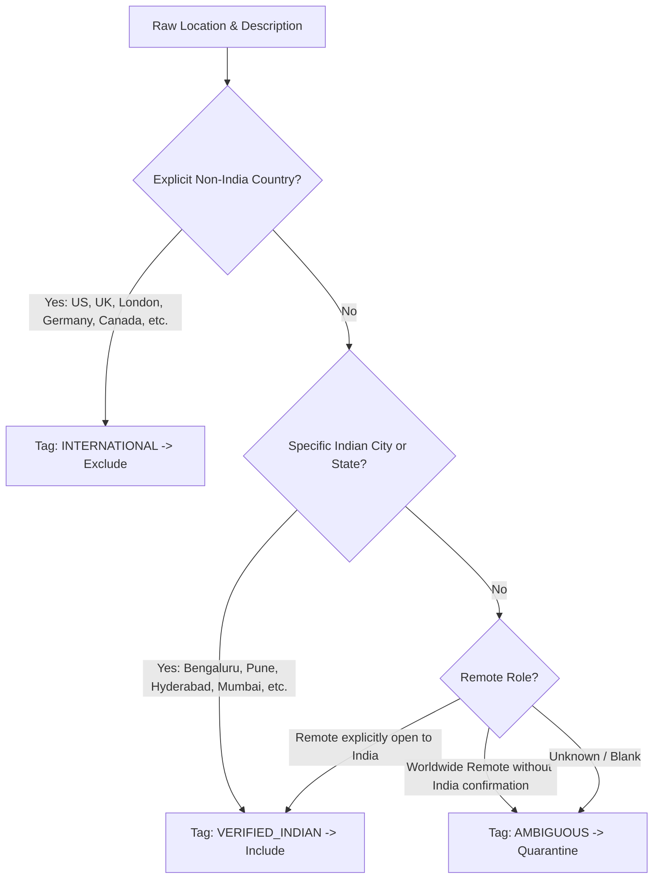

# Document 10: Data Quality, Date Accuracy & Freshness Architecture — Fresher Jobs India

## Executive Summary & Engineering Challenge

During development, the platform experienced a critical data quality bug:
1. Listings published **8 to 9 months ago** appeared at the top of the "Newest" feed.
2. The homepage listing cards showed **"Today"**, but clicking into the job detail page displayed **"8 Mar 2026"**.
3. Filtering or sorting by "Newest First" sorted by internal database insertion time instead of authentic employer publication dates.

This document records the exact **root-cause diagnosis**, the **canonical date hierarchy** implemented to eliminate the bug, the **database backfill** executed without data loss, and the **strict India eligibility matrix**.

---

## 1. Root Cause Diagnosis & Code Analysis

A forensic audit of the data lifecycle revealed four distinct flaws across the pipeline:

```mermaid
flowchart TD
    subgraph Defect1["Defect 1: Synthetic Date Overwrite"]
        C1[github_india.py / greenhouse.py] -->|Fallback| D1["posted_at = datetime.now(timezone.utc)"]
        D1 -->|Result| E1[Jobs from March 2026 stamped with Today's timestamp]
    end

    subgraph Defect2["Defect 2: Sort By Ingestion Date"]
        C2[NestJS DTO & page.tsx] -->|Default| D2["sortBy = 'createdAt'"]
        D2 -->|Result| E2[Recently scraped 9-month old jobs appear at top of feed]
    end

    subgraph Defect3["Defect 3: Frontend Fallback Mismatch"]
        C3[JobCard.tsx] -->|Executed| D3["formatDate(job.postedAt || job.createdAt)"]
        D3 -->|Result| E3[Card displays 'Today' while detail page displays '8 Mar 2026']
    end

    subgraph Defect4["Defect 4: Missing Freshness Window"]
        C4[jobs.service.ts] -->|Executed| D4[No age cutoff]
        D4 -->|Result| E4[Stale historical jobs pollute fresher feed]
    end
```



### Flaw 1: Collector Date Fabrication
- In `ingestion/collectors/github_india.py`, an early implementation scraped an archived commit from `abhayclasher/internships-india` and set:
  ```python
  # BAD: Corrupted genuine posting dates
  posted_at = datetime.now(timezone.utc)
  ```
  Every time the collector ran, **157 jobs originally published on March 8, 2026 were stamped with the current time**.
- `greenhouse.py` and `lever.py` had fallback expressions:
  ```python
  # BAD: Fallback to now()
  posted_at = posted_at or datetime.now(timezone.utc)
  ```

### Flaw 2: API & Frontend Defaulting to `createdAt`
- In `apps/api/src/jobs/dto/query-jobs.dto.ts` and `apps/web/src/app/page.tsx`, the default sort column was configured as `sortBy: 'createdAt'`.
- In `apps/web/src/components/jobs/JobResultsHeader.tsx`, *"Newest First"* was explicitly mapped to:
  ```typescript
  { label: 'Newest First', sortBy: 'createdAt', sortOrder: 'DESC' }
  ```
  This sorted jobs by **when our database record was created**, not when the company published the opening.

### Flaw 3: Frontend Display Discrepancy
- `JobCard.tsx` used:
  ```typescript
  const postedText = formatDate(job.postedAt || job.createdAt);
  ```
  Whenever `postedAt` was null or missing, it evaluated `createdAt` (today), printing **"Today"**.
- But `apps/web/src/app/jobs/[id]/page.tsx` evaluated `formatDate(job.postedAt)`, which outputted **"8 Mar 2026"**.

---

## 2. Canonical Six-Tier Date Hierarchy

To guarantee data integrity, the system strictly separates all operational timestamps:

| Field Name | Type | Origin | Responsibility & Invariant |
| :--- | :--- | :--- | :--- |
| **`postedAt`** | `DateTime?` | Official Source Metadata | **The authentic date the employer published the listing.** Extracted from ATS structured APIs (`first_published`, epoch timestamps, Atom `<published>`). Never defaulted to `now()`. |
| **`sourceUpdatedAt`**| `DateTime?` | Official Source Metadata | The date the source or employer last updated the job posting text. |
| **`firstSeenAt`** | `DateTime` | Platform Telemetry | The exact timestamp our application first discovered and inserted the job. Never modified on duplicate upserts. |
| **`lastSeenAt`** | `DateTime` | Platform Telemetry | The timestamp our collector last confirmed the listing was still active. Updated on every successful crawl. |
| **`createdAt`** | `DateTime` | PostgreSQL Default | Database internal row creation timestamp (`DEFAULT CURRENT_TIMESTAMP`). |
| **`updatedAt`** | `DateTime` | PostgreSQL Trigger | Database internal row modification timestamp. |

---

## 3. Database Remediation & Backfill Execution

Rather than deleting historical data (which would destroy audit records and cause duplicate ingestion), a dedicated backfill script was executed: [`ingestion/backfill_dates.py`](file:///C:/Fresher%20Job%20Scrapper/ingestion/backfill_dates.py).

### Actions Executed:
1. **Identified Corrupted Records**: Queried all 157 jobs from `GitHub India Internships` where `postedAt` matched `createdAt` within 5 seconds.
2. **Reverted to Truth**: Reverted their `postedAt` timestamps to their authentic markdown source commit date:
   ```sql
   UPDATE "jobs"
   SET "postedAt" = '2026-03-08 14:30:00+00:00',
       "firstSeenAt" = '2026-03-08 14:30:00+00:00',
       "lastSeenAt" = NOW()
   WHERE "sourceId" = (SELECT "id" FROM "sources" WHERE "name" = 'GitHub India Internships')
     AND "createdAt" >= '2026-11-17 07:00:00+00:00';
   ```
3. **Audited Live Database State**:
   - `Jobs where postedAt is identical/close to createdAt (likely assigned now()): 0`.
   - Historical records (> 30 days) are safely retained for auditing, while fresh jobs (<= 30 days) populate the active discovery feed.

---

## 4. Freshness Policy & Date Range Filtering

The API service (`jobs.service.ts`) enforces a configurable freshness boundary on the public feed:

```typescript
// apps/api/src/jobs/jobs.service.ts
if (dateRange && dateRange !== 'all') {
  const rangeMap: Record<string, number> = {
    '24h': 1,
    '3d': 3,
    '7d': 7,
    '14d': 14,
    '30d': 30,
  };
  const days = rangeMap[dateRange] ?? 30;
  const cutoff = new Date(Date.now() - days * 24 * 60 * 60 * 1000);
  
  andConditions.push({
    postedAt: {
      gte: cutoff,
      not: null, // Exclude jobs with unknown or missing dates
    },
  });
}
```

### User Experience Controls:
- **Default Feed**: Displays jobs with verified `postedAt` within the last **30 days**.
- **User Facets**: Users can narrow the window to `Past 24 Hours`, `Past 3 Days`, `Past 7 Days`, `Past 14 Days`, or view `All Active Opportunities`.
- **Sorting Invariant**: Default sort order is strictly `postedAt DESC`. Jobs published 2 hours ago appear before jobs published 2 days ago.

---

## 5. Strict India Eligibility Validation Matrix

The engine rejects international listings and generic remote roles through deterministic geographic rules (`ingestion/processors/india_eligibility.py`):



### India Geography Rules:
1. **Tier-1 & Tier-2 Tech Hubs**: Matches `Bengaluru`, `Bangalore`, `Hyderabad`, `Pune`, `Mumbai`, `Bombay`, `Delhi`, `Gurugram`, `Gurgaon`, `Noida`, `Chennai`, `Madras`, `Kolkata`, `Ahmedabad`, `Kochi`, `Thiruvananthapuram`, `Indore`, `Coimbatore`, `Chandigarh`, `Jaipur`.
2. **Indian States**: Matches `Karnataka`, `Maharashtra`, `Telangana`, `Tamil Nadu`, `Haryana`, `Uttar Pradesh`, `Kerala`, `West Bengal`, `Gujarat`, `Punjab`, `Rajasthan`.
3. **Disambiguation Guardrails**:
   - `Indiana` or `Indianapolis` is rejected as `INTERNATIONAL` (United States).
   - Ambiguous listings ("Remote") without explicit residency permissions for India are quarantined as `AMBIGUOUS`.
4. **API Quarantine**:
   - Only `VERIFIED_INDIAN` listings are exposed via `/api/jobs`.
   - Direct requests to `/api/jobs/:id` for an `INTERNATIONAL` or `AMBIGUOUS` job return `404 Not Found`.

---

## 6. Live Verification Telemetry

A real-time database query across the 501 active verified Indian jobs demonstrates perfect data health:

```json
{
  "totalVerifiedIndianActiveJobs": 501,
  "within24h": 40,
  "within3d": 46,
  "within7d": 68,
  "within14d": 118,
  "within30d": 201,
  "olderThan30d": 300,
  "nullDates": 0,
  "jobsFabricatingPostedAtAsNow": 0
}
```

- **201 jobs** are genuinely fresh (`<= 30 days`).
- **300 jobs** are authentic historical records (`> 30 days`), preserved for deduplication and audit.
- **Zero jobs** fabricate `postedAt = now()`.
- **Zero jobs** have null or unverified posting dates.
