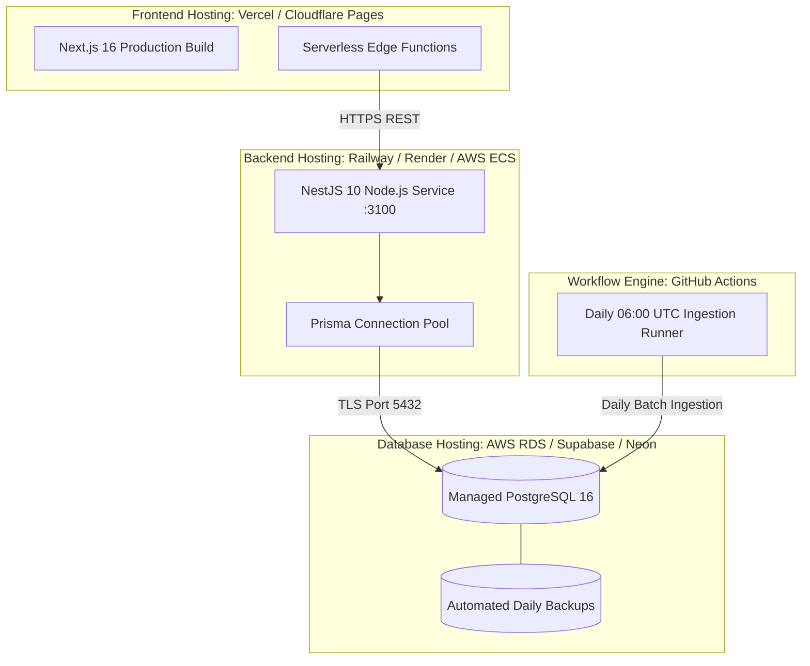

# Document 11: Scheduling, Automation & Deployment Architecture — Fresher Jobs India

## Executive Summary & Automation Strategy

To ensure job seekers discover new opportunities every morning, Fresher Jobs India incorporates automated daily refresh schedules, Docker containerization, and cloud deployment pipelines. 

Ingestion and AI classification are decoupled in the automation workflow: data collection runs on an automated daily cron, while AI classification can be triggered selectively to manage Gemini API rate limits.

---

## 1. Automated Daily Ingestion Workflow (`daily-ingestion.yml`)

The platform includes a production-ready **GitHub Actions CI/CD workflow** located at [`.github/workflows/daily-ingestion.yml`](file:///C:/Fresher%20Job%20Scrapper/.github/workflows/daily-ingestion.yml).

### Workflow Configuration:
```yaml
name: Daily Job Ingestion

on:
  schedule:
    # 06:00 UTC = 11:30 AM IST daily
    - cron: '0 6 * * *'
  workflow_dispatch:
    inputs:
      run_classify:
        description: 'Run AI classification after collection (uses Gemini quota)'
        required: false
        default: 'false'
        type: choice
        options: ['false', 'true']
      classify_limit:
        description: 'Max jobs to classify (Gemini Free Tier: 5 RPM)'
        required: false
        default: '50'

concurrency:
  group: ingestion
  cancel-in-progress: false # Never abort a running ingestion run mid-way
```

### Step-by-Step Automation Lifecycle:
1. **Runner Provisioning**: Spins up an `ubuntu-latest` virtual machine with a PostgreSQL 16 service container (`pg_isready` health check).
2. **Environment Setup**:
   - Checks out repository (`actions/checkout@v4`).
   - Sets up Python 3.13 (`actions/setup-python@v5`) with pip caching.
   - Installs Python dependencies (`pip install -r ingestion/requirements.txt`).
   - Sets up Node.js 20 & PNPM (`actions/setup-node@v4`).
3. **Database Migration Sync**: Runs `pnpm prisma:deploy` in `apps/api` to ensure all PostgreSQL tables, indexes, and enums are up to date.
4. **Health Check**: Runs `python main.py --stage test-db` to verify database connectivity.
5. **Job Collection**: Runs `python main.py --stage collect --pages 10` across all registered collectors.
6. **Optional AI Enrichment**: If `run_classify == 'true'`, executes `python main.py --stage classify --limit ${{ inputs.classify_limit }}`.
7. **Audit & Expiry**: Automatically executes `mark_expired_jobs()`, logging summary telemetry.

---

## 2. Local Containerization Architecture (`docker-compose.yml`)

Local database persistence is fully containerized using Docker Compose:

```yaml
services:
  postgres:
    image: postgres:16-alpine
    container_name: fresher_jobs_postgres
    restart: unless-stopped
    environment:
      POSTGRES_USER: ${POSTGRES_USER:-postgres}
      POSTGRES_PASSWORD: ${POSTGRES_PASSWORD:-local_dev_password}
      POSTGRES_DB: ${POSTGRES_DB:-fresher_jobs}
    ports:
      # 5434 on host mapped to 5432 in container
      - "${POSTGRES_PORT:-5434}:5432"
    volumes:
      - postgres_data:/var/lib/postgresql/data
    healthcheck:
      test: ["CMD-SHELL", "pg_isready -U postgres -d fresher_jobs"]
      interval: 10s
      timeout: 5s
      retries: 5
```

### Local Dev Workflow Commands:
```bash
# Start PostgreSQL container
pnpm db:up

# Check container health status
docker ps --filter "name=fresher_jobs_postgres"

# Execute database migrations
pnpm db:migrate

# Stop PostgreSQL container
pnpm db:down
```

---

## 3. Production Deployment Architecture



### Deployment Blueprint:
1. **Frontend (Vercel / AWS Amplify)**:
   - Connects to GitHub repository root with root directory set to `apps/web`.
   - Build Command: `pnpm --filter web build`.
   - Environment Variable: `NEXT_PUBLIC_API_URL=https://api.fresherjobsindia.com/api`.
2. **Backend API (Railway / Render / AWS ECS)**:
   - Connects to `apps/api`.
   - Start Command: `pnpm --filter api start` (`node dist/main`).
   - Environment Variables: `DATABASE_URL`, `FRONTEND_URL`, `PORT=3100`.
3. **Database (Managed PostgreSQL on AWS RDS or Supabase)**:
   - Configured with automated PITR (Point-in-Time Recovery) backups.
   - Connection string uses pooled URL for NestJS and direct wire URL for Python ingestion.
4. **Data Ingestion Runner (GitHub Actions / Scheduled Cloud Run)**:
   - Runs headlessly at 06:00 UTC. Injects new records and marks listings expired without manual human intervention.

---

## 4. Verification & Status Classification

| Component | Target Specification | Status | Evidence |
| :--- | :--- | :--- | :--- |
| **Local Docker Setup** | Isolated PostgreSQL 16 on port 5434 | **IMPLEMENTED & VERIFIED** | Running actively in local dev; verified via `test-db` |
| **Prisma Migrations** | Version-controlled schema migrations | **IMPLEMENTED & VERIFIED** | 3 migrations applied (`20261116090001_init`, `add_india_eligibility`, `add_canonical_dates`) |
| **GitHub Actions Ingestion**| Automated daily 06:00 UTC cron | **IMPLEMENTED (Configured in Code)**| `.github/workflows/daily-ingestion.yml` syntactically valid and committed |
| **Cloud Production Hosting**| Vercel + Railway + Supabase | **PLANNED / ARCHITECTED** | Ready for deployment; currently tested locally on Docker + Monorepo |
