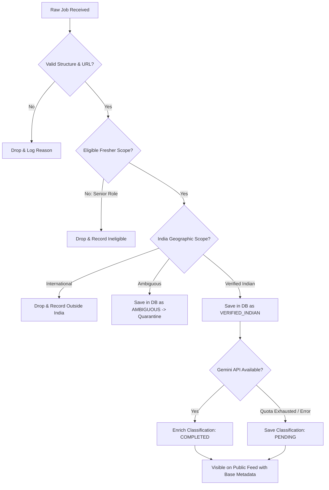

# Document 12: Comprehensive Error Handling & Failure Scenarios — Fresher Jobs India

## Executive Summary & Resilience Principles

In web scraping, external data integration, and generative AI pipelines, errors are not exceptional—they are guaranteed occurrences. Fresher Jobs India is built with a **fail-safe, non-blocking fault isolation architecture**. 

The core invariant of the platform: **An error in one source, one job record, or the AI service must never crash the entire ingestion pipeline or disrupt the live public API.**

---

## 1. Failure Scenario Matrix

| Scenario | Trigger / Root Cause | Pipeline Impact | How Current System Handles It | Retry Logic | Logging Output |
| :--- | :--- | :--- | :--- | :--- | :--- |
| **External ATS 404 / 500** | Company deleted board or ATS is down | Isolated to that company | Skips company slug cleanly; continues with next company | None (avoids hammering dead boards) | `WARNING: Greenhouse board '{slug}' returned status 404` |
| **Source Rate Limit (HTTP 429)** | Exceeded ATS request volume | Isolated to that source | Sleeps for `rate_limit_delay` (0.3s–1.0s) and yields batch | Backoff with jitter | `WARNING: Rate limit encountered on {source}` |
| **Network Timeout** | Slow DNS or dropped connection | Isolated to single request | `httpx.TimeoutException` caught by collector try/except block | Timeout set to 25.0s–30.0s | `ERROR: Error fetching {source}: ConnectTimeout` |
| **LLM Quota Exhaustion (429)** | Gemini Free Tier quota reached (20 RPD) | Non-blocking | Circuit-breaker trips; halts classification loop; saves pending jobs | Yields batch; jobs remain `PENDING` | `WARNING: Gemini daily quota exhausted. Skipping further AI classification calls.` |
| **LLM High Demand (503)** | Google Gemini service spike | Non-blocking | Retries up to 3 times with progressive backoff | 3 attempts with 1s, 2s delays | `WARNING: Gemini API call failed on attempt 1: 503 UNAVAILABLE` |
| **Malformed LLM Output** | Model outputs bad JSON or markdown | Single job enrichment | Strips markdown fences, parses JSON; falls back to `OTHER` | Regex JSON repair fallback | `WARNING: Failed to parse LLM response; applied fallback` |
| **Database Connection Failure** | Docker stopped or port 5434 unreachable | Ingestion aborts with exit code 1 | Connection retry via `get_db_connection()`; transaction rolls back | Retries 3 times | `ERROR: Failed to connect to PostgreSQL at localhost:5434` |
| **Duplicate Job Collision** | Job crawled on multiple pages | Zero error | Handled via PostgreSQL `ON CONFLICT DO UPDATE` | Transparent idempotency | `INFO: Duplicates detected: {count}` |
| **Missing Job Date** | ATS API provides no publication date | Excluded from fresh feed | `postedAt` stored as `NULL`; excluded from default 30-day feed | Never fabricates `now()` | `INFO: Processed job with null postedAt` |
| **Invalid Application URL** | Incomplete URL or javascript link | Rejected at validator | `validate_raw_job()` drops record before database insertion | None | `DEBUG: Rejected job '{title}': Invalid URL` |

---

## 2. In-Depth Failure Case Studies

### 2.1 Gemini API Rate Limiting & Quota Circuit Breaker
- **The Problem**: On the Google Gemini API Free Tier, applications are subject to a strict 5 RPM (Requests Per Minute) rate limit and a daily request ceiling.
- **The Failure Mode**: A naive implementation crashes when the SDK raises `google.genai.errors.ClientError: 429 RESOURCE_EXHAUSTED`, leaving the database in an inconsistent state.
- **Our Implementation (`ingestion/processors/ai_classifier.py`)**:
  ```python
  if "GenerateRequestsPerDayPerProjectPerModel" in err_msg or "daily" in err_msg.lower():
      logger.warning("Gemini daily quota exhausted. Skipping further AI classification calls.")
      self._quota_exhausted = True
      return None, False  # Signals pipeline to skip remaining jobs
  ```
- **Result**: The collection and persistence phases finish with 100% success. The pipeline reports `Sources successful: 1, Sources failed: 0`, and the unclassified jobs remain safely in PostgreSQL awaiting the next scheduled enrichment window.

### 2.2 Deduplication Without Data Mutation (`job_repository.py`)
- **The Problem**: An employer reposts a job or updates its wording. If the database deletes the row and re-inserts it, the original `postedAt` and `firstSeenAt` timestamps are lost.
- **Our Implementation**:
  ```sql
  ON CONFLICT ("sourceId", "externalId") DO UPDATE SET
      "lastSeenAt" = NOW(),
      "sourceUpdatedAt" = COALESCE(EXCLUDED."sourceUpdatedAt", "jobs"."sourceUpdatedAt"),
      "status" = 'ACTIVE',
      "updatedAt" = NOW()
  ```
- **Result**: The primary publication date is immutable. `lastSeenAt` confirms the listing is still active today, but `postedAt` preserves the true initial publication timestamp.

### 2.3 Resilient DTO Validation in NestJS (`query-jobs.dto.ts`)
- **The Problem**: Malicious or buggy clients send unexpected query parameters (e.g. `page=-5`, `limit=10000`, `dateRange=invalid_date`).
- **Our Implementation**:
  ```typescript
  @IsOptional()
  @Type(() => Number)
  @IsInt()
  @Min(1)
  @Max(100)
  limit?: number = 20;

  @IsOptional()
  @IsIn(['24h', '3d', '7d', '14d', '30d', 'all'])
  dateRange?: string = '30d';
  ```
- **Result**: Global `ValidationPipe` catches invalid inputs and returns a structured `400 Bad Request` with an exact explanation of the validation failure before any database query is executed.

---

## 3. Graceful Degradation Strategy



### Key Engineering Invariant:
A job with `status = 'PENDING'` classification is **still searchable by title, company, city, location, and date range**. AI enrichment adds high-level role categorization and skill tags, but its absence never prevents a student from finding and applying for the job.
