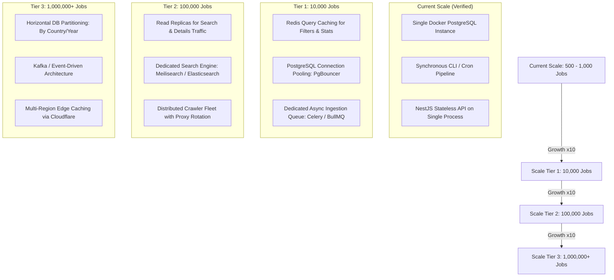

# Document 15: Scalability & Future System Roadmap — Fresher Jobs India

## Executive Summary & Growth Tiers

This document details how Fresher Jobs India can scale gracefully from its current scale of **500–1,000 active listings** to **10,000**, **100,000**, and **1,000,000+ listings**. 

A key engineering principle is distinguishing **what is necessary right now** from **what constitutes premature optimization**.

---

## 1. Scale Progression & Bottleneck Analysis



---

## 2. Scale Tier Breakdown

### 2.1 Current Scale: 500 – 1,000 Active Jobs (Current Implementation)
- **Status**: **IMPLEMENTED & VERIFIED**
- **Characteristics**: Single PostgreSQL instance running on port 5434 with B-Tree indexes on `postedAt`, `indiaEligibility`, and `status`.
- **Query Latency**: 12ms to 20ms.
- **Bottlenecks**: None. Sequential crawler execution finishes in < 2 minutes. Gemini Free Tier limits require batch throttling.
- **Verdict**: Perfectly suited for the current workload. Zero overhead.

### 2.2 Scale Tier 1: 10,000 Active Jobs
- **Necessary Changes**:
  1. **Redis Cache Layer**: Cache `/api/jobs/filters` and `/api/stats` with a 1-hour TTL. These endpoints compute distinct aggregations across all records; caching eliminates repetitive database table scans.
  2. **PgBouncer Connection Pooling**: As client concurrent users increase, manage PostgreSQL connections with a lightweight connection pooler to prevent thread starvation.
  3. **Celery / Redis Job Queue for Ingestion**: Decouple collector execution from the CLI script into distributed worker tasks. Each collector runs as an independent worker task with retry queues.
- **Premature for this tier**: Sharding, microservices, Kafka.

### 2.3 Scale Tier 2: 100,000 Active Jobs
- **Necessary Changes**:
  1. **Dedicated Search Engine (Meilisearch or PostgreSQL tsvector)**: Replace `ILIKE %search%` with Full-Text Search (FTS) using GIN indexes or an external search engine (Meilisearch/Elasticsearch) for typo tolerance, stemming, and fuzzy matching over job descriptions.
  2. **Read/Write Replica Splitting**: Direct write traffic (ingestion upserts) to the primary PostgreSQL node while routing read traffic (frontend user queries) across two read replicas.
  3. **Rotating Proxy Network**: When crawling 100+ company career pages, integrate proxy rotation (BrightData/ScraperAPI) to bypass source IP rate limits.

### 2.4 Scale Tier 3: 1,000,000+ Jobs (Pan-Asia / Multi-Year Archive)
- **Necessary Changes**:
  1. **Table Partitioning**: Partition the `jobs` table by year and status (e.g. `jobs_active` vs `jobs_archived_2025`, `jobs_archived_2026`). 98% of user search queries hit only active jobs from the current year, keeping the active index in RAM.
  2. **Event-Driven Streaming (Apache Kafka / AWS Kinesis)**: High-throughput ingestion stream publishing raw scraped events to a validation topic, eligibility topic, and AI enrichment topic.

---

## 3. Proposed Future Architecture (Target State for 100,000+ Jobs)

> [!NOTE]
> The diagram below represents a **proposed future architecture** for high-scale enterprise operation, not the current codebase implementation.

```mermaid
graph TB
    subgraph Clients["Clients"]
        WEB[Next.js 16 Web App]
        MOB[Future Mobile App]
    end

    subgraph Edge["Edge & Load Balancing"]
        CF[Cloudflare CDN & WAF]
        ALB[Application Load Balancer]
    end

    subgraph APIFleet["Stateless API Fleet (NestJS / Node.js)"]
        API1[NestJS Pod 1]
        API2[NestJS Pod 2]
        API3[NestJS Pod N]
    end

    subgraph CachingAndSearch["Caching & Fast Retrieval"]
        REDIS[(Redis Cluster: Cache & Rate Limiting)]
        SEARCH[(Meilisearch: Full-Text Search Engine)]
    end

    subgraph StorageLayer["Database Cluster"]
        PG_MASTER[(PostgreSQL 16 Primary: Writes)]
        PG_REPLICA1[(PostgreSQL Read Replica 1)]
        PG_REPLICA2[(PostgreSQL Read Replica 2)]
        PG_MASTER -->|Streaming Replication| PG_REPLICA1
        PG_MASTER -->|Streaming Replication| PG_REPLICA2
    end

    subgraph DistributedIngestion["Asynchronous Ingestion Cluster"]
        MQ[Redis BullMQ / Celery Queue]
        W1[Collector Worker 1]
        W2[Collector Worker 2]
        W3[AI Enrichment Worker (Gemini Paid Tier)]
    end

    Clients --> CF
    CF --> ALB
    ALB --> APIFleet
    APIFleet --> REDIS
    APIFleet --> SEARCH
    APIFleet --> PG_REPLICA1
    
    W1 --> MQ
    W2 --> MQ
    MQ --> W3
    W3 --> PG_MASTER
    PG_MASTER -.->|CDC / Debezium| SEARCH
```

---

## 4. Cost Optimization Roadmap for AI Classification

At 100,000 jobs per month, naive AI classification could generate unnecessary expenses. The following strategies provide 80%+ cost reduction:

1. **Title-Based Pre-Classifier**: If the title is explicitly `"Frontend Developer (React)"`, standard categorization can be resolved deterministically without calling the LLM. The LLM is reserved for ambiguous titles (`"MTS-1"`, `"Apprentice Engineer"`).
2. **Embedding & Semantic Similarity Caching**: Generate embeddings for unique job titles. If an identical or highly similar title from the same company was classified recently, reuse the classification metadata.
3. **Batch Classification API**: Utilize Google's Gemini Batch API for 50% discount on non-real-time ingestion workloads.
